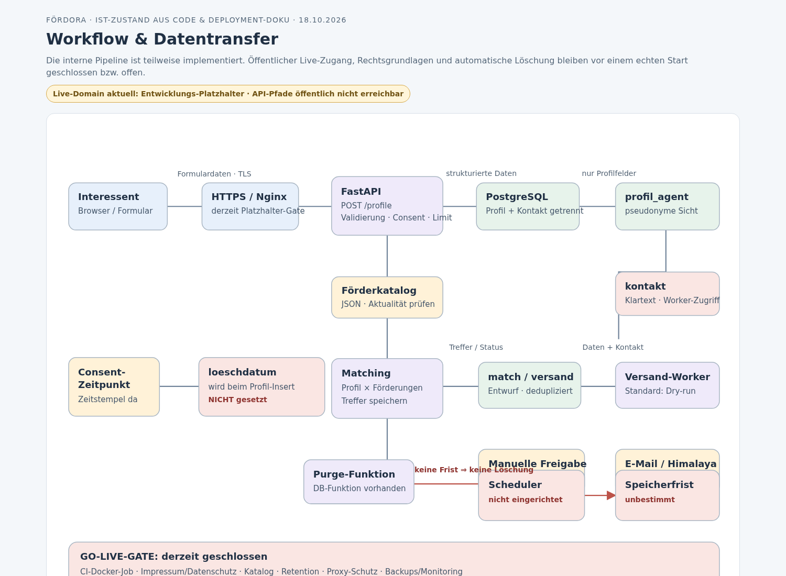

# FoerderRadar — Diagramme

## Aktueller Workflow (Stand 18.10.2026)

- Quelldatei: [foerdora-zielworkflow.html](foerdora-zielworkflow.html)
- Die Grafik zeigt den aktuellen Datenfluss und offene Go-live-Gates. Sie ist keine Freigabe zum Livegang.

## Frühere Konzeptdiagramme

Stand der Entwürfe: **27.09.2026**; nicht mit dem aktuellen Code-/Deploymentstand abgeglichen.

- **Datenfluss & Use Cases (UC1–UC6)** — [SVG](foerderradar-usecases.svg) / [PNG](foerderradar-usecases.png)
- **Wann läuft was (Zeitplan)** — [SVG](foerderradar-zeitplan.svg) / [PNG](foerderradar-zeitplan.png)
- **Module, Funktionen & Ablauf** — [SVG](foerderradar-module.svg) / [PNG](foerderradar-module.png)
- **Datenfluss (erste Version)** — [SVG](foerderradar-datenfluss.svg) / [PNG](foerderradar-datenfluss.png)

SVG-Dateien sind editierbare Textdateien; PNG-Dateien sind Vorschauen.
